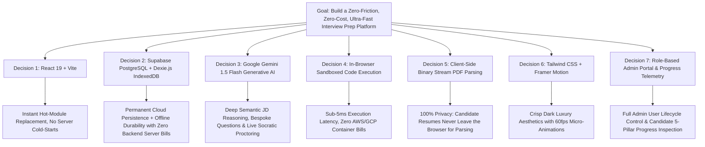

# 🧠 PrepAI — Engineering Decisions & Architecture Log

Welcome to the **Decisions & Rationale Hub** for **PrepAI**. This directory documents the engineering decisions, technology evaluations, architectural trade-offs, and workflows that shaped the creation of this AI placement preparation platform.

---

## 📑 Directory Navigation

| Document | Purpose & Key Topics |
| :--- | :--- |
| **[1. Tech Stack Justifications](file:///c:/Users/Preety/OneDrive/Desktop/task%202/decision/tech-stack-justifications.md)** | Detailed justifications for JavaScript (ESM), React 19, Vite, Tailwind CSS, Supabase (PostgreSQL), Google Gemini 3.8 Flash (`@google/generative-ai`), Dexie.js (IndexedDB), Framer Motion, Chart.js, and Lucide Icons. |
| **[2. Architecture Decision Records (ADRs)](file:///c:/Users/Preety/OneDrive/Desktop/task%202/decision/adrs.md)** | Formal ADR-001 to ADR-009 logs documenting Context, Decision, Consequences, and Alternatives considered (including ADR-007 for Supabase, ADR-008 for Gemini 1.5 Flash, and ADR-009 for Role-Based Admin Management & Candidate Progress Oversight). |
| **[3. Workflows & Developer Pipelines](file:///c:/Users/Preety/OneDrive/Desktop/task%202/decision/workflow-and-pipelines.md)** | Step-by-step candidate journey workflows, algorithm execution flowcharts, Supabase migration pipelines, Gemini question generation, admin user management and candidate progress tracking, and developer onboarding instructions. |
| **[4. Trade-offs & Future Roadmap](file:///c:/Users/Preety/OneDrive/Desktop/task%202/decision/tradeoffs-and-future-roadmap.md)** | Technical trade-offs (multi-tier persistence, client-side vs cloud judge, heuristic NLP vs Gemini LLM API, RBAC in client-side vs backend) and the future scalability roadmap. |

---

## 💡 Executive Summary of Key Decisions

1. **Why Role-Based Admin Portal & Progress Telemetry?**  
   Recruiters, hiring managers, and bootcamps need operational visibility into candidate growth. The Admin Console (`AdminModal.jsx`) provides real-time oversight of candidate $N$-day roadmap completion, daily task checklists, historical test scores, and 5-pillar radar scores (Code Quality, System Design, Problem Solving, Communication, Complexity Optimization), coupled with complete user account lifecycle controls (CRUD, Status Toggling, Role Promotion, Password Reset).
2. **Why Google Gemini 1.5 Flash?**  
   While deterministic rules handle basic keyword matching, Gemini 1.5 Flash brings human-level technical evaluation: analyzing complex, nuanced Job Descriptions, generating custom coding challenges with verified test cases, and providing real-time Socratic hints based on the candidate's active code editor buffer.
3. **Why Supabase + IndexedDB Dual-Tier Persistence?**  
   Pure cloud storage fails when offline or during flaky network conditions; pure local storage is lost if a candidate switches computers or clears browser caches. By integrating Supabase (PostgreSQL) as the permanent cloud sync engine and Dexie (IndexedDB) as the high-capacity local cache, PrepAI provides the best of both worlds: permanent cross-device durability with instant sub-millisecond offline resilience.
4. **Why In-Browser Sandboxed Execution?**  
   Interview prep platforms typically suffer from server queue times, expensive Docker sandboxes (like Judge0), and backend API cold starts. By shifting execution to the client runtime, PrepAI achieves **instantaneous response times, zero server infrastructure costs, and complete candidate data privacy**.
5. **Why not Next.js SSR?**  
   Server-Side Rendering adds unnecessary Node.js server overhead and hydration mismatches for an interactive tool that relies entirely on client-side state, local file uploads, and browser audio/canvas APIs. Vite SPA was chosen for peak reactivity and static hostability.
