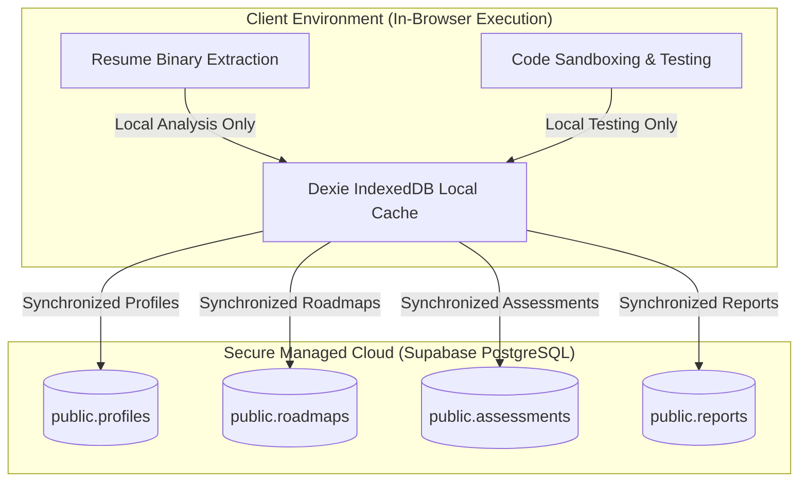
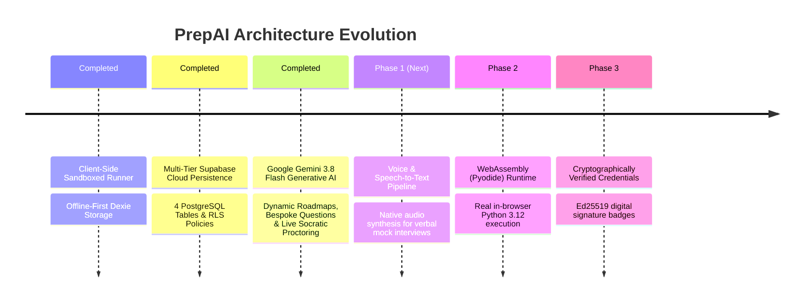

# ⚖️ Architectural Trade-offs & Future Production Roadmap

## 1. Architectural Trade-offs Matrix

Every engineering architecture involves conscious trade-offs between speed, cost, complexity, privacy, and capability. Here is the evaluation matrix for the key technical choices in PrepAI:

| Architectural Choice | Key Benefits Gained | Trade-offs & Limitations Accepted | Mitigation Implemented |
| :--- | :--- | :--- | :--- |
| **Multi-Tier Persistence (Supabase + Dexie.js)** | • Permanent cross-device cloud persistence. • Works offline without interruption. • Instant sub-millisecond local reads. • Zero custom backend servers to host. | • Requires public anon key in client environment. • Potential sync divergence if user modifies records offline. | • PostgreSQL Row-Level Security (RLS) protects data. • `db.js` writes to both Supabase and IndexedDB simultaneously. |
| **In-Browser Sandboxed Code Execution** | • Zero cloud server cost. • Sub-10ms test execution. • Unlimited concurrent candidate scaling. | • Execution is limited to JavaScript natively. • Heavy while-loops could theoretically block the UI thread. | • Structured test cases with short inputs. • Clear instructions that JS is native; other tracks provide structural test simulations. |
| **Heuristic NLP & Regex Skill Matching** | • Zero API latency. • Zero API token costs. • Works reliably offline without API keys. | • Lacks the deep generative reasoning of a 70B LLM for idiosyncratic sentence structures. | • Comprehensive dictionary of 25+ industry standard keywords and seniority marker heuristics. |
| **Modal-First Workspace Layer** | • Seamless single-page experience. • Zero page-reload delay. • Retains underlying candidate dashboard state. | • Deep URLs for sharing specific modal states require custom state routing. | • Modals receive target question IDs via props; easily extendable to query parameters (`?modal=dsa&id=two-sum`). |

---

## 2. Security & Privacy Posture

* **Candidate Privacy Compliance**: Resume parsing occurs entirely within browser memory (`Uint8Array`) on the candidate's machine. Only calibrated roadmap objects, test scores, and performance rubrics are synced to Supabase.
* **Row-Level Security (RLS)**: Public client access policies are explicitly defined on each table, allowing safe client-side writes via the anon public key without exposing full database admin rights.

---

## 3. Production Roadmap Evolution

### ✅ Status Update: Supabase Cloud & Gemini 3.8 Flash Active in Production
* **Supabase Cloud PostgreSQL**: Live tables (`profiles`, `roadmaps`, `assessments`, `reports`) with RLS policies and `@supabase/supabase-js`.
* **Google Gemini 3.8 Flash Generative AI**: Configured in `.env` and `src/utils/geminiService.js`. Delivers live AI proctoring, dynamic question synthesis, and deep resume-to-JD roadmap calibration with automatic algorithmic fallback.

---

### Upcoming Phases:

### Phase 1: Generative LLM & Native Voice Integration
* **Integration**: Connect optional user-provided Gemini or OpenAI API keys.
* **Feature**: Voice-activated AI proctor using browser `SpeechRecognition` and `SpeechSynthesis` APIs to simulate an authentic verbal FAANG interview loop with spoken follow-up questions.

### Phase 2: WebAssembly Multi-Language Runtime (Pyodide & Clang Wasm)
* **Integration**: Load Pyodide (`pyodide.org`) WebAssembly binary on demand.
* **Feature**: True client-side Python execution without a backend server, allowing candidates to run native `numpy`, Python list comprehensions, and Pythonic unit tests directly in the browser sandbox.

### Phase 3: Cryptographically Verified Interview Credentials
* **Integration**: Ed25519 digital signatures.
* **Feature**: Performance reports generate a signed verification link that candidates can embed in their LinkedIn profiles or send to hiring managers to prove mastery of 5-pillar technical competencies.
