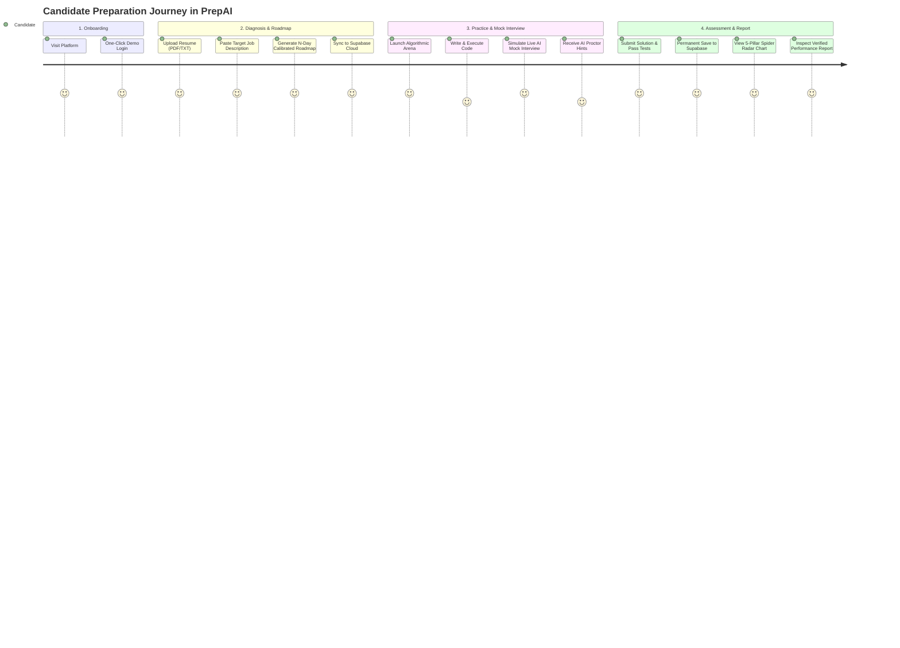
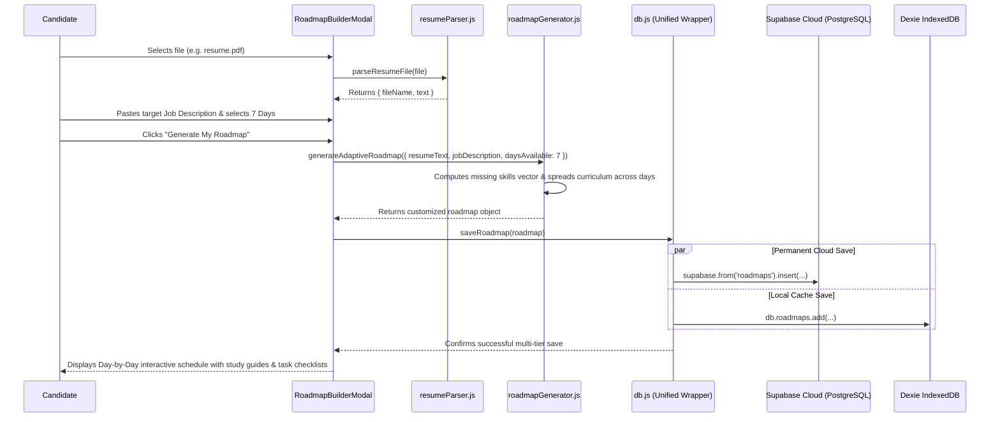
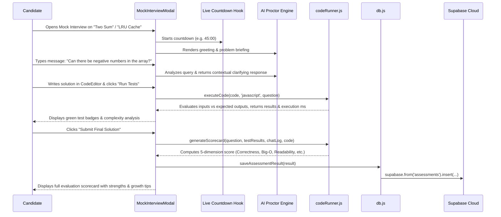
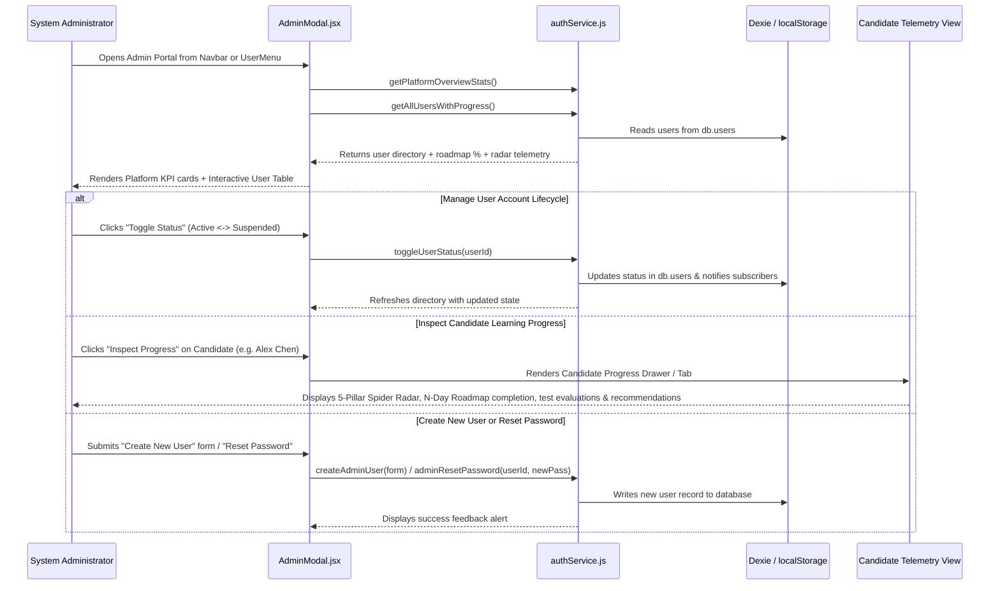

# 🔄 Workflows & Developer Pipelines

This document provides step-by-step walkthroughs of both **End-to-End Candidate Workflows** and **Developer Pipelines** to make the codebase intuitive to navigate and maintain.

---

## 1. Candidate User Journey Workflows



---

### Workflow A: Resume Ingestion, Roadmap Calibration & Supabase Cloud Sync



---

### Workflow B: Live AI Mock Interview Session & Assessment Sync



---

### Workflow C: Administrator User Management & Candidate Progress Oversight



---

## 2. Developer Pipelines & Extension Guide

### How to Run the Project Locally
```bash
# 1. Navigate to the project directory
cd "c:\Users\Preety\OneDrive\Desktop\task 2\prepai"

# 2. Configure your Supabase credentials in .env
# VITE_SUPABASE_URL=https://your-project.supabase.co
# VITE_SUPABASE_ANON_KEY=your-anon-key-here

# 3. Start the Vite development server
npm run dev

# 4. Open in browser:
# http://localhost:5174/ (or http://localhost:5173/)
```

---

### Pipeline 1: Supabase Cloud Database Migrations

Whenever modifying table schemas, update `supabase-schema.sql` and run in the **Supabase Dashboard SQL Editor**:

```sql
-- Example: Adding a new column to assessments
ALTER TABLE public.assessments ADD COLUMN IF NOT EXISTS feedback_notes TEXT;
```

---

### Pipeline 2: Adding a New Interview Problem to `questionsData.js`

To add a new problem to the coding arena and mock interview room, open `src/utils/questionsData.js` and append an entry to `MOCK_QUESTIONS`:

```javascript
{
  id: 'valid-parentheses',
  title: 'Valid Parentheses & Bracket Validation',
  difficulty: 'Easy',
  category: 'Stacks & Parsing',
  timeLimitMinutes: 20,
  starterCode: {
    javascript: `function isValid(s) {\n  // Implement O(N) stack solution\n  return true;\n}`,
    python: `def is_valid(s: str) -> bool:\n    # Implement solution\n    return True`,
  },
  testCases: [
    { input: { s: "()" }, expected: true },
    { input: { s: "()[]{}" }, expected: true },
    { input: { s: "(]" }, expected: false }
  ],
  optimalSolution: `function isValid(s) {\n  const stack = [];\n  const map = { ')': '(', '}': '{', ']': '[' };\n  for (let char of s) {\n    if (char in map) {\n      if (stack.pop() !== map[char]) return false;\n    } else { stack.push(char); }\n  }\n  return stack.length === 0;\n}`,
  theory: [
    { title: 'Stack Invariants', content: 'LIFO structures guarantee innermost brackets match first.' }
  ],
  aiProctorResponses: [
    'Welcome! How would you handle an odd-length string right away?'
  ]
}
```

---

### Pipeline 3: Expanding the Resume Parser Skill Vector in `resumeParser.js`

To recognize additional technologies, open `src/utils/resumeParser.js` and add keywords to `SKILL_KEYWORDS`:

```javascript
const SKILL_KEYWORDS = [
  'React', 'JavaScript', 'TypeScript', 'Node.js', 'Python', 'Go', 'Java', 'C++',
  'PostgreSQL', 'MongoDB', 'Redis', 'Kafka', 'Docker', 'Kubernetes', 'AWS',
  'GraphQL', 'gRPC', 'Microservices', 'System Design', 'Algorithms', 'SQL',
  'Next.js', 'Tailwind', 'CI/CD', 'Git', 'Distributed Systems',
  // Add new technologies below:
  'Rust', 'Solidity', 'PyTorch', 'TensorFlow', 'Terraform', 'WebSockets', 'Supabase'
];
```

---

### Pipeline 4: Leveraging Google Gemini 3.8 Flash for Dynamic AI Features

To utilize Gemini for AI features, add your API key in `.env`:
```env
VITE_GEMINI_API_KEY=your-gemini-key-here
```
Or set it directly in the candidate UI via the **Set Gemini API Key** button.

1. **Dynamic Roadmaps**: Called via `generateRoadmapWithGemini({ resumeText, jobDescription, daysAvailable })`.
2. **Dynamic Problem Synthesis**: Triggered in the Mock Interview modal via `+ Gemini Question` or `generateInterviewQuestionWithGemini({ topic, difficulty })`.
3. **Conversational Mock Interview Proctor**: Evaluated during live chats via `askGeminiProctor(...)` which receives the candidate's active code buffer and chat history.

---

### Pipeline 5: Admin User Management & Candidate Progress Telemetry Extension

To extend administrative controls or integrate external telemetry sources, utilize the helper functions in `src/utils/authService.js`:

```javascript
import {
  getAllUsersWithProgress,
  createAdminUser,
  updateUser,
  deleteUser,
  toggleUserStatus,
  toggleUserRole,
  adminResetPassword,
  getPlatformOverviewStats,
} from './utils/authService';

// 1. Fetch complete platform summary metrics
const stats = await getPlatformOverviewStats();
// => { totalUsers, candidateCount, adminCount, activeCount, suspendedCount, platformAvgScore, avgRoadmapCompletion, strongHireRate }

// 2. Fetch enriched candidate directory with roadmap & radar telemetry
const directory = await getAllUsersWithProgress();
// Each user contains user.progress: { roadmap: { progressPercent, completedTasks }, assessments: { avgScore, recentTests }, radarScores: { codeQuality, systemDesign, ... } }

// 3. Programmatically provision candidate or admin accounts
await createAdminUser({
  name: 'Marcus Vance',
  email: 'marcus@prepai.io',
  password: 'password123',
  role: 'candidate', // or 'admin'
  status: 'active',  // or 'suspended'
  targetRole: 'Senior Cloud Engineer',
  targetCompany: 'AWS',
});

// 4. Update status or reset credentials
await toggleUserStatus(userId); // Active <-> Suspended
await adminResetPassword(userId, 'temporaryPassword123');
```
