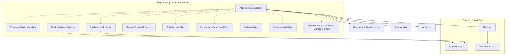

# 🧩 PrepAI — Component & Modal Architecture

## 1. Component Hierarchy

---

## 2. Component Inventory & Functional Responsibilities

### 1. Landing & Navigation Elements

| Component | File Path | Role & Key Features |
| :--- | :--- | :--- |
| **`App.jsx`** | `src/App.jsx` | Top-level orchestrator. Maintains `activeModal`, handles global `ESC` keyboard dismiss, connects to `authService.js` observer. |
| **`Hero.jsx`** | `src/components/Hero.jsx` | High-conversion hero banner. Contains animated badge, dynamic typing text, and primary Call-To-Action (CTA) triggers to launch the Roadmap Builder and DSA Arena. |
| **`UserMenu.jsx`** | `src/components/UserMenu.jsx` | Displays logged-in candidate state, avatar badge, target role, and logout/switch profile dropdown. |
| **`Features.jsx`** | `src/components/Features.jsx` | 6-card feature grid detailing Resume Matcher, DSA Sandbox, AI Proctor, System Design blueprints, Analytics, and Roadmap generator. |
| **`About.jsx`** | `src/components/About.jsx` | Value proposition showcase: why AI-driven calibrated preparation outperforms traditional static LeetCode grinding. |
| **`AnimatedText.jsx`** | `src/components/AnimatedText.jsx` | High-frequency character-by-character typewriter effect for hero titles. |

---

### 2. Interactive Modals

#### A. `RoadmapBuilderModal.jsx`
* **Purpose**: Multi-step wizard to calibrate an $N$-day preparation plan.
* **Inputs**:
  * Resume upload (file dropzone supporting PDF, TXT, MD, DOC) or manual resume pasting.
  * Target Job Description (JD) text.
  * Available days slider ($2$ to $30$ days).
  * Target company profile (FAANG, Unicorn, Early Startup, Enterprise).
  * **Google Gemini AI Engine**: Integrated status badge (`● Gemini 3.8 Flash Connected`), inline key editor, and one-click "Generate with Gemini" action.
* **Output**: Calibrated day-by-day roadmap persisted permanently to Supabase Cloud and Dexie IndexedDB with direct links to practice problems.

#### B. `MockInterviewModal.jsx`
* **Purpose**: Full-featured simulated technical interview room.
* **Core Sub-Panels**:
  * **Question & Constraints Column**: Problem description, examples, time/space targets, plus **`+ Gemini Question`** generator button to synthesize bespoke technical challenges on any topic.
  * **Code Editor Panel (`CodeEditor.jsx`)**: Syntax-highlighted live coding area with language selector (JavaScript, Python).
  * **Live AI Proctor Panel (Powered by Gemini 3.8 Flash)**: Real-time conversational AI interviewer reading the candidate's active code buffer and chat inquiries, giving Socratic hints and edge-case feedback.
  * **Live Timer & Proctor Controls**: Countdown clock with time warnings and submission trigger.
  * **Test Case Runner**: Immediate execution of test suites with green/red test status indicators.
  * **Scorecard Evaluation View**: Generates a 5-dimension score (Correctness, Code Quality, Time Complexity, Communication, Edge Cases) synchronized to Supabase Cloud.

#### C. `DsaPracticeModal.jsx`
* **Purpose**: Dedicated LeetCode-style algorithm practice arena.
* **Features**:
  * Problem catalog filtering (Arrays, Two Pointers, Linked Lists, Caching, System Design).
  * Multi-tab workspace: Code Editor, Official Optimal Solution, Theory Notes, and Custom Test Cases.
  * Quick-run button with instant pass/fail metrics and time/memory estimates.

#### D. `ResumeReviewModal.jsx`
* **Purpose**: Deep-dive resume-to-JD gap analysis.
* **Features**:
  * Match Percentage calculation ($0-100\%$).
  * Discovered Skills pills (green tags).
  * Missing JD Keywords (red warning tags).
  * Seniority classification (L3 Entry to L6+ Staff/Principal).
  * Actionable bullet-point improvements to beat Applicant Tracking Systems (ATS).

#### E. `AnalyticsModal.jsx`
* **Purpose**: Visual skills matrix and interview readiness tracking.
* **Visualizations**:
  * **5-Pillar Spider/Radar Chart**: Powered by Chart.js (`DSA`, `System Design`, `Communication`, `Problem Solving`, `Code Quality`).
  * **Historical Assessment Trend**: Tracks score trajectories over time.
  * **Readiness Score Gauge**: Aggregated percentage readiness with recommendations.

#### F. `PerformanceReportModal.jsx`
* **Purpose**: Comprehensive printable report card for candidates to share with mentors or review before interviews.
* **Sections**: Summary metrics, detailed rubric breakdowns, strengths, growth areas, and verified completion badge.

#### G. `AuthModal.jsx`
* **Purpose**: Complete client-side authentication system.
* **Features**:
  * Tabbed login and sign-up forms.
  * Form validation with user-friendly error prompts.
  * 1-Click "Demo Candidate" login for instant testing.
  * Password reset simulated flow.

#### H. `AdminModal.jsx`
* **Purpose**: Enterprise Administration Portal & Candidate Progress Oversight Engine.
* **Navigation Trigger**: Click "Admin Portal" pill in header navbar, or click "Admin Console" in the `UserMenu` profile dropdown.
* **Core Views**:
  * **1. Platform KPI Overview**:
    * Total Users registered across the platform (Candidates vs Admins).
    * Active vs Suspended user counts.
    * Real-time $N$-day roadmap completion rate across active candidates.
    * Average platform assessment score and Strong Hire hiring recommendation percentage.
  * **2. User Directory Management (CRUD & Governance)**:
    * Search filter across candidate name, email, target company, and target role.
    * Role filter (`All`, `Candidate`, `Admin`) and Status filter (`All`, `Active`, `Suspended`).
    * Inline modal to Create New Candidate or Administrator with role selection and company assignment.
    * Edit user details (Name, Target Track, Target Company, Role).
    * 1-click status toggle: Activate or Suspend accounts with immediate auth session revocation.
    * 1-click role toggle: Elevate candidates to administrators or demote administrators.
    * Secure password reset modal with preset new passwords.
    * Account deletion with automatic fallback cleanup.
  * **3. Candidate Progress & Telemetry Inspector**:
    * In-depth learning journey drawer for any candidate.
    * **$N$-Day Roadmap Tracking**: Visual completion progress bar, active phase indicator (e.g. Day 5 of 7: Core Competency & Caching), and completed task ratio ($16/21$ tasks).
    * **Daily Milestone Checklist**: Interactive task cards showing completed vs remaining study topics.
    * **Assessment History**: Total tests evaluated, benchmark pass rate, latest hiring recommendation tag, and recent test rounds (title, score, date).
    * **5-Pillar Spider Radar Telemetry**: Real-time breakdown of Code Quality, System Design, Problem Solving, Communication, and Complexity Optimization scores.
    * Direct "Launch Live Mock on Target Track" action for technical interviewers.
  * **4. Administrator Authorization Gate**:
    * If unauthenticated or currently logged in as a candidate, an authentication gate blocks access to administrative metrics.
    * **Admin Credentials**:
      * **Username**: `admin` (or email: `admin@prepai.io`)
    * Features secure credential verification, real-time error banners, and a "Lock Console" action in the admin header.

---

### 3. Reusable Subcomponents

#### `CodeEditor.jsx`
* **Props**: `code` (string), `onChange` (function), `language` (string).
* **Design**:
  * Line number gutter calculation (`code.split('\n').map(...)`).
  * Tab-key interception for proper 2-space indentation instead of shifting keyboard focus.
  * Dark IDE skin with monospace typography and active line highlight.
