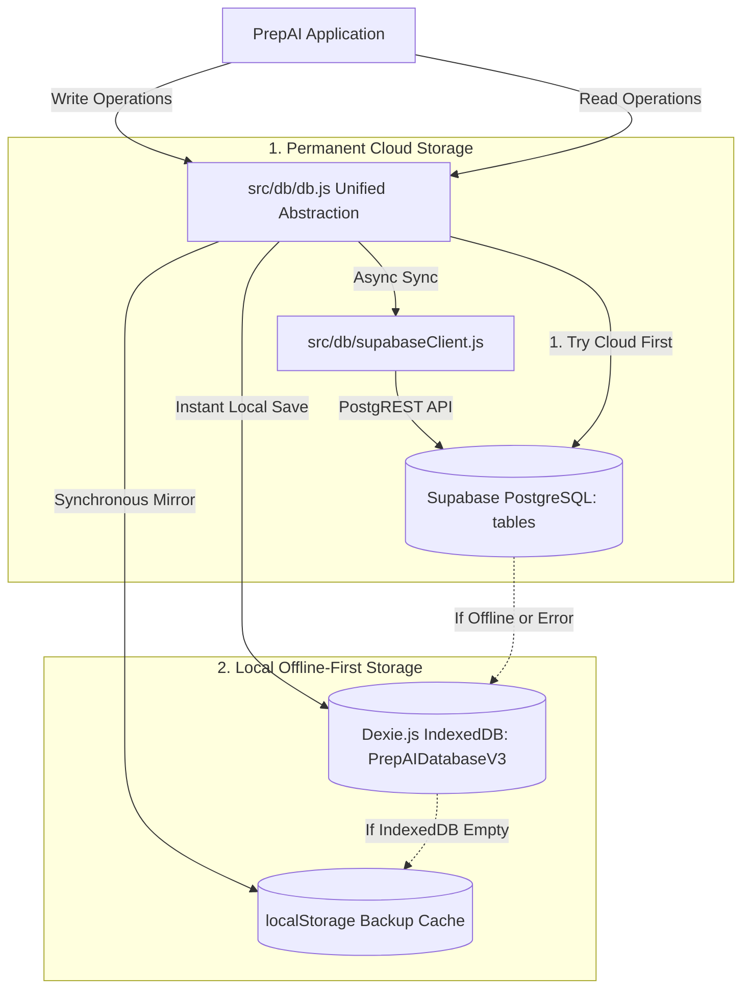
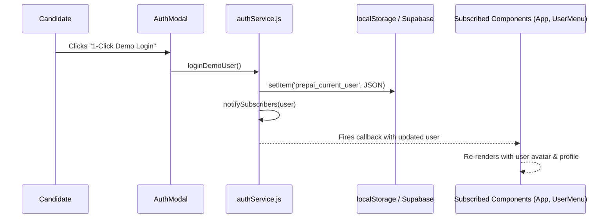

# 🗄️ PrepAI — Database & State Architecture

## 1. Storage Strategy: Cloud Sync + Offline-First Hybrid Persistence

PrepAI implements a **3-Tier Cloud & Offline-First Hybrid Storage Architecture**:
1. **Primary Cloud Layer**: **Supabase (PostgreSQL)** for permanent cross-device persistence, candidate history tracking, and global accessibility.
2. **Local High-Capacity Cache**: **IndexedDB (via Dexie.js)** for instant sub-millisecond local reads and offline resilience.
3. **Emergency Fallback Cache**: **`localStorage`** for synchronous state recovery if IndexedDB or network access is restricted.



---

## 2. Supabase Cloud PostgreSQL Database Schema

The cloud database is hosted on **Supabase** (`PostgreSQL 15+`) with Row-Level Security (RLS) enabled.

### Table Schema Definitions

```sql
-- 1. Candidate Profiles & Skill Vectors
CREATE TABLE public.profiles (
  id UUID DEFAULT gen_random_uuid() PRIMARY KEY,
  target_role TEXT,
  days_available INT,
  skills TEXT[] DEFAULT '{}',
  seniority TEXT,
  created_at TIMESTAMPTZ DEFAULT timezone('utc'::text, now()) NOT NULL
);

-- 2. Calibrated N-Day Roadmaps
CREATE TABLE public.roadmaps (
  id UUID DEFAULT gen_random_uuid() PRIMARY KEY,
  target_role TEXT,
  target_company TEXT,
  days_count INT,
  daily_plans JSONB DEFAULT '[]'::jsonb,
  created_at TIMESTAMPTZ DEFAULT timezone('utc'::text, now()) NOT NULL
);

-- 3. Coding Submissions & Test Runs
CREATE TABLE public.assessments (
  id UUID DEFAULT gen_random_uuid() PRIMARY KEY,
  question_title TEXT,
  overall_score NUMERIC,
  scorecard JSONB DEFAULT '{}'::jsonb,
  test_results JSONB DEFAULT '[]'::jsonb,
  candidate_code TEXT,
  execution_time_ms INT DEFAULT 0,
  created_at TIMESTAMPTZ DEFAULT timezone('utc'::text, now()) NOT NULL
);

-- 4. 5-Pillar Readiness Reports
CREATE TABLE public.reports (
  id UUID DEFAULT gen_random_uuid() PRIMARY KEY,
  overall_readiness NUMERIC,
  radar_scores JSONB DEFAULT '{}'::jsonb,
  strengths TEXT[] DEFAULT '{}',
  growth_areas TEXT[] DEFAULT '{}',
  created_at TIMESTAMPTZ DEFAULT timezone('utc'::text, now()) NOT NULL
);
```

### Security & Row-Level Security (RLS)
Public anonymous access policies allow client-side persistence through the publishable anonymous API key:
```sql
CREATE POLICY "Allow public read/insert on profiles" ON public.profiles FOR ALL USING (true) WITH CHECK (true);
CREATE POLICY "Allow public read/insert on roadmaps" ON public.roadmaps FOR ALL USING (true) WITH CHECK (true);
CREATE POLICY "Allow public read/insert on assessments" ON public.assessments FOR ALL USING (true) WITH CHECK (true);
CREATE POLICY "Allow public read/insert on reports" ON public.reports FOR ALL USING (true) WITH CHECK (true);
```

---

## 3. Local IndexedDB Schema (`PrepAIDatabaseV3`)

The Dexie instance in `src/db/db.js` maintains local mirrored schemas:

```javascript
import Dexie from 'dexie';

export const db = new Dexie('PrepAIDatabaseV3');

db.version(1).stores({
  users: '++id, email, name, targetRole, createdAt',
  profiles: '++id, targetRole, daysAvailable, createdAt',
  roadmaps: '++id, targetRole, targetCompany, createdAt',
  assessments: '++id, questionTitle, overallScore, createdAt',
  reports: '++id, overallReadiness, createdAt',
});
```

---

## 4. Multi-Tier Write & Read Pipeline in `db.js`

Every storage operation follows a graceful degradation strategy:

```javascript
export async function saveRoadmap(roadmap) {
  // 1. Sync to Supabase Cloud if online and configured
  if (isSupabaseConfigured && supabase) {
    try {
      await supabase.from('roadmaps').insert([{
        target_role: roadmap.targetRole,
        target_company: roadmap.targetCompany,
        days_count: roadmap.daysCount,
        daily_plans: roadmap.dailyPlans,
        created_at: new Date().toISOString(),
      }]);
    } catch (err) {
      console.warn('Supabase roadmap save error:', err);
    }
  }

  // 2. Persist to IndexedDB for offline instant access
  try {
    const { id, ...data } = roadmap;
    await db.roadmaps.add({ ...data, createdAt: new Date().toISOString() });
  } catch (err) {
    console.warn('Dexie save error, falling back to localStorage', err);
  }

  // 3. Mirror into localStorage for backup
  localStorage.setItem('prepai_active_roadmap', JSON.stringify(roadmap));
  return Date.now();
}
```

### Read Prioritization
1. **Supabase Cloud**: First attempts fetching the latest record from Supabase ordered by `created_at DESC`.
2. **IndexedDB**: If offline, network fails, or Supabase returns no rows, reads from local Dexie database.
3. **LocalStorage**: If IndexedDB is blocked (e.g. strict private mode), parses local storage.

---

## 5. Reactive Authentication Event Bus (`authService.js`)

Candidate authentication utilizes an **Observer Pattern** to ensure all mounted modals and navigation bars update reactively whenever a user logs in, switches accounts, or logs out.



---

## 6. Role-Based User Management & Candidate Progress Telemetry State

### 1. User Entity Schema

```typescript
interface UserEntity {
  id: string;                      // Unique ID (e.g. 'user_admin_0', 'user_alex_1')
  username?: string;               // Optional username identifier (e.g. 'admin')
  name: string;                    // Full candidate or administrator name
  email: string;                   // Email address (unique key)
  password?: string;               // Plaintext / hashed credential (e.g. 'admin123')
  role: 'admin' | 'candidate';     // Role-Based Access Control tier
  status: 'active' | 'suspended';  // Account lifecycle governance state
  targetRole: string;              // Target interview career track (e.g. 'Senior Full Stack Engineer')
  targetCompany: string;           // Target employer tier (e.g. 'Google (L5)', 'Meta (L6)')
  avatarUrl?: string | null;       // Unsplash or uploaded avatar portrait
  createdAt: string;               // ISO 8601 registration timestamp
  lastActive?: string;             // Humanized activity indicator (e.g. '10 mins ago')
}
```

### 2. Candidate Progress Telemetry Model

```typescript
interface CandidateProgressTelemetry {
  roadmap: {
    daysAvailable: number;         // Total duration of prep plan (e.g. 7 days)
    currentDay: number;            // Current active milestone (e.g. Day 5)
    totalTasks: number;            // Total tasks scheduled across curriculum
    completedTasks: number;        // Completed milestone count
    progressPercent: number;       // Calculated progress percentage (0 - 100)
    status: string;                // 'Active (On Track)' | 'Needs Attention' | 'Suspended'
    lastPhase: string;             // Current curriculum phase description
  };
  assessments: {
    testsTaken: number;            // Total live coding rounds submitted
    avgScore: number;              // Aggregate benchmark score (0 - 100)
    passRate: number;              // Test assertion pass rate (0 - 100%)
    latestRecommendation: string;  // 'Strong Hire' | 'Hire' | 'Needs Practice'
    recentTests: Array<{
      title: string;
      score: number;
      date: string;
      recommendation: string;
    }>;
  };
  radarScores: {
    codeQuality: number;           // 0 - 100 score on clean code & idioms
    systemDesign: number;          // 0 - 100 score on distributed architecture
    problemSolving: number;        // 0 - 100 score on algorithmic reasoning
    communication: number;         // 0 - 100 score on proctor dialogue
    complexityOptimization: number;// 0 - 100 score on Big-O space/time
  };
  activityLog: Array<{
    text: string;
    time: string;
  }>;
}
```

### 3. Administrative Mutation & Aggregation APIs (`authService.js`)

| Method | Parameters | Return Type | Operational Description |
| :--- | :--- | :--- | :--- |
| `getAllUsersWithProgress()` | `void` | `Promise<UserWithProgress[]>` | Enriches user directory with real-time roadmap, assessment, and 5-pillar radar telemetry. |
| `getPlatformOverviewStats()` | `void` | `Promise<PlatformKPIs>` | Computes platform metrics: user counts, active roadmaps, avg score, and Strong Hire rates. |
| `createAdminUser()` | `userData: Partial<UserEntity>` | `Promise<UserEntity>` | Validates, seeds, and persists new user to Dexie DB and LocalStorage. |
| `updateUser()` | `userId: string, updates: Partial<UserEntity>` | `Promise<UserEntity>` | Applies partial mutations to user fields and updates active session if currently logged in. |
| `toggleUserStatus()` | `userId: string` | `Promise<UserEntity>` | Toggles between `'active'` and `'suspended'`. Suspended users are locked out of login. |
| `toggleUserRole()` | `userId: string` | `Promise<UserEntity>` | Promotes `'candidate'` to `'admin'` or demotes `'admin'` to `'candidate'`. |
| `adminResetPassword()` | `userId: string, newPass?: string` | `Promise<UserEntity>` | Sets a fresh password for the user, restoring locked access. |
| `deleteUser()` | `userId: string` | `Promise<boolean>` | Deletes user from database. If deleting current user, triggers clean logout. |
| `verifyAdminCredentials()` | `identifier: string, password: string` | `Promise<UserEntity>` | Authenticates administrator credentials (`admin` / `admin123`) before unlocking Admin Console. |
| `loginAsAdmin()` | `void` | `Promise<UserEntity>` | 1-Click quick login as Master Administrator (`admin` / `admin123`) for evaluator testing. |
