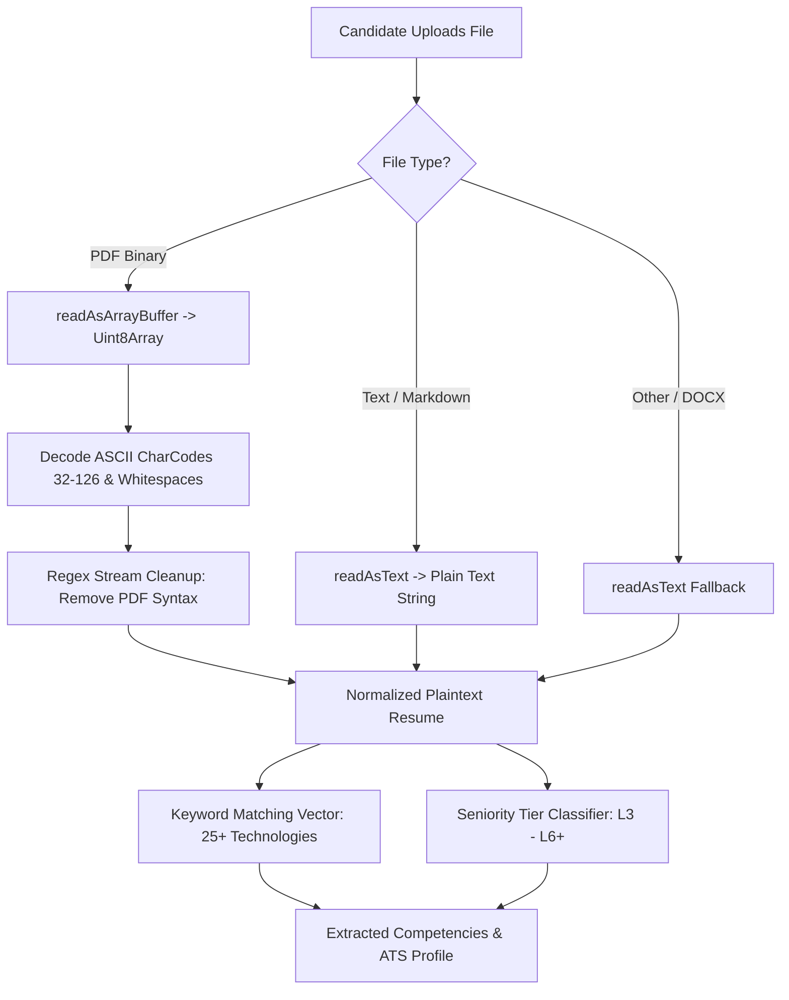
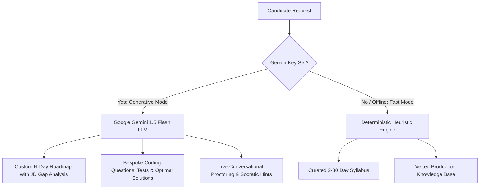

# ⚙️ PrepAI — Engines & Algorithmic Specifications

## 1. Document Ingestion & Resume Parsing Engine (`resumeParser.js`)

The Resume Ingestion Engine processes applicant files in multiple formats (`.pdf`, `.txt`, `.md`, `.doc`) directly inside the browser using native `FileReader` primitives.



### PDF Stream Extraction Algorithm
Traditional web apps send PDF files to server-side Python libraries or paid cloud OCR APIs. PrepAI parses PDFs instantly in the client using a fast ASCII byte-stream extraction loop:

```javascript
const uint8 = new Uint8Array(buffer);
let rawString = '';
for (let i = 0; i < Math.min(uint8.length, 150000); i++) {
  const charCode = uint8[i];
  if (charCode >= 32 && charCode <= 126) {
    rawString += String.fromCharCode(charCode);
  } else if (charCode === 10 || charCode === 13) {
    rawString += ' ';
  }
}
const cleanText = rawString
  .replace(/\/[A-Za-z0-9]+/g, ' ')
  .replace(/[\\(\\)\\[\\]<>]/g, ' ')
  .replace(/\s+/g, ' ')
  .trim();
```

### Seniority Classification Heuristic
The engine applies rule-based heuristic weights against seniority keywords:
* **Staff / Principal (L6+)**: Keywords `staff`, `principal`, `architect`, `8+`, `10+ years`.
* **Senior Software Engineer (L5)**: Keywords `senior`, `lead`, `5+`, `6+`, `7+ years`.
* **Entry / Associate Engineer (L3)**: Keywords `junior`, `intern`, `associate`, `graduate`, `entry`.
* **Mid-Level (L4)**: Default classification when no explicit markers match.

---

## 2. Adaptive Roadmap Generation Algorithm (`roadmapGenerator.js`)

The roadmap algorithm takes the candidate's resume competency vector, the targeted Job Description (JD), and available days $N \in [2, 30]$ to synthesize a day-by-day prep curriculum.

### Step-by-Step Logic:
1. **Semantic JD Scan**:
   * Evaluates if the JD emphasizes **System Design & Distributed Scalability** (`distributed`, `scale`, `architecture`, `microservices`, or Seniority $\ge \text{L5}$).
   * Evaluates if the JD emphasizes **Concurrency & High-Throughput** (`kafka`, `go`, `multithreading`).
   * Evaluates if the JD emphasizes **Full-Stack & Frontend Systems** (`react`, `typescript`, `ui`).
2. **Skill Gap Vector Math**:
   $$\text{Missing Skills} = \text{JD Required Skills} \setminus \text{Resume Extracted Skills}$$
   Items in $\text{Missing Skills}$ are assigned higher priority in early calendar days.
3. **Curriculum Temporal Distribution**:
   The engine selects from modular topics and dynamically distributes them across the requested day count $N$:
   * **Early Phase (Days $1 \dots \lfloor N/3 \rfloor$)**: Core Algorithms, Hash Maps, Pointers, and Data Structure foundations.
   * **Middle Phase (Days $\lfloor N/3 \rfloor + 1 \dots \lfloor 2N/3 \rfloor$)**: Complex Data Structures (LRU Cache, Graphs), Distributed System Design, and Concurrency.
   * **Final Phase (Days $\lfloor 2N/3 \rfloor + 1 \dots N$)**: Behavioral STAR narratives, Live Mock Simulations, and Full Mock Interview rounds.

---

## 3. Sandboxed Code Execution & Test Evaluator (`codeRunner.js`)

To provide LeetCode-grade interactive verification without a remote code execution cluster:

```javascript
const wrappedCode = `
  ${code}
  return typeof twoSum !== 'undefined' ? twoSum : 
         typeof LRUCache !== 'undefined' ? LRUCache : 
         typeof DistributedRateLimiter !== 'undefined' ? DistributedRateLimiter : null;
`;
const executable = new Function(wrappedCode)();
```

### Test Case Assertion Engine
For algorithm questions (e.g., Two Sum):
* The evaluator passes structured test inputs (`tc.input.nums`, `tc.input.target`).
* Compares actual outputs with expected outputs taking commutativity into account:
  $$\text{passed} = (o_0 == e_0 \land o_1 == e_1) \lor (o_0 == e_1 \land o_1 == e_0)$$
* Benchmarks runtime via `performance.now()` to compute execution time in milliseconds.

---

## 4. Multi-Pillar Scorecard & Rubric Engine (`generateScorecard`)

When a candidate finishes a coding or mock session, `generateScorecard()` computes a balanced evaluation across **5 core competencies**:

```mermaid
radar-chart
    title Candidate Performance Rubric
    axis DSA, System Design, Communication, Problem Solving, Code Quality
    Candidate : [92, 85, 88, 90, 86]
    Target Benchmark : [80, 80, 80, 80, 80]
```

### Scoring Formula:
$$\text{Overall Score} = \sum_{i=1}^5 (w_i \times s_i)$$

| Dimension ($i$) | Weight ($w_i$) | Evaluation Criteria |
| :--- | :--- | :--- |
| **Correctness & Edge Cases** | $35\%$ | Percentage of automated test cases passed without runtime errors. |
| **Time & Space Complexity** | $25\%$ | Optimal algorithmic Big-O ($O(N)$ vs $O(N^2)$ brute force). |
| **Code Structure & Readability** | $15\%$ | Naming conventions, modularization, and defensive guards. |
| **Communication & Clarification** | $15\%$ | Candidate messages sent to AI proctor and clarifying questions. |
| **System Architecture Rigor** | $10\%$ | Scalability trade-offs and concurrency considerations. |

The aggregate result feeds directly into the candidate's **Performance Report** and IndexedDB historical trend records.

---

## 5. Google Gemini 1.5 Flash Generative Engine (`geminiService.js`)

To complement the deterministic heuristic engine, PrepAI integrates **Google Gemini 1.5 Flash** via `@google/generative-ai` for open-ended generative capabilities.



### A. Dynamic Roadmap Synthesis (`generateRoadmapWithGemini`)
* Sends candidate's raw parsed resume text and target Job Description directly to Gemini.
* Instructs the model to output a strict, zero-hallucination JSON payload conforming to the exact PrepAI roadmap schema (`dailyPlans`, `tasks`, `studyGuide`, `estimatedHours`).
* If network errors occur, the UI catches the exception and falls back to `roadmapGenerator.js` seamlessly.

### B. Dynamic Question & Test Case Generator (`generateInterviewQuestionWithGemini`)
* Generates infinite real-world coding problems on demand for any user-specified topic (e.g., *Dynamic Programming*, *Graph BFS*, *Distributed Token Bucket*).
* Generates paired JavaScript and Python starter stubs, mathematically correct test assertion suites, optimal solutions with Big-O analysis, and theoretical foundation notes.

### C. Live Socratic Mock Interview Proctor (`askGeminiProctor`)
* Ingests the candidate's active code buffer (`candidateCode`), current problem statement, and chat history.
* Functions as a senior technical interviewer: answers clarifying questions about input boundaries, gives progressive hints without leaking answers, and challenges the candidate on edge-case complexity.
