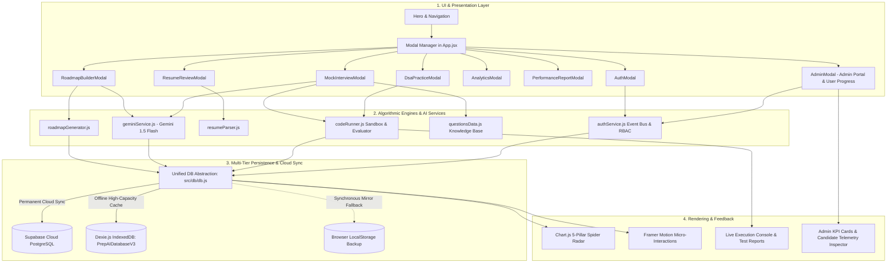
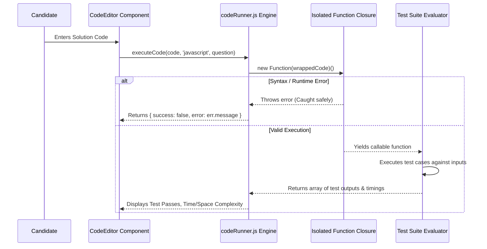

# 🏛️ PrepAI — System Architecture Specification

## 1. High-Level Architecture Overview

PrepAI is architected as an **Edge-Reactive, Offline-First, Cloud-Synchronized Single Page Application (SPA)**. Instead of relying on monolithic backend application servers, compute workloads (document parsing, adaptive curriculum scheduling, JavaScript execution sandboxing, and rubric scoring) run client-side in the browser, while persistent data is automatically synchronized with a **Supabase (PostgreSQL)** cloud backend and cached locally in **IndexedDB**.

---

## 2. Layered Architecture Breakdown

### Layer 1: Presentation & Modal Orchestration
* **Root Orchestrator (`App.jsx`)**: Maintains active modal state (`activeModal`), global keyboard traps (Escape key listeners), and subscribes to the auth listener.
* **Component Encapsulation**: Each major feature (including the new `AdminModal`) is encapsulated as an isolated modal dialog with backdrop blurs (`backdrop-blur-md`), preventing layout shift in the primary landing page.
* **Declarative Animation Engine**: Framer Motion controls mounting/unmounting transitions using `<AnimatePresence>` for fluid, zero-jank entrance and exit animations.

### Layer 2: Business Logic & Algorithmic Engines
1. **`geminiService.js` (Google Gemini 1.5 Flash Generative Engine)**:
   * Generates tailored day-by-day roadmaps through deep resume-to-JD gap analysis (`generateRoadmapWithGemini`).
   * Generates bespoke coding challenges with multi-language starter code, automated test suites, and optimal solutions (`generateInterviewQuestionWithGemini`).
   * Powers live conversational mock interview proctoring with progressive Socratic hints based on active code buffer (`askGeminiProctor`).
2. **`resumeParser.js` (Document Ingestion Engine)**:
   * Inspects MIME types and extensions (`.pdf`, `.txt`, `.md`, `.doc`).
   * Extracts raw text streams directly from PDF `ArrayBuffer` binaries without requiring cloud OCR.
   * Runs tokenized dictionary scans to compute seniority tier (L3 through L6+) and extracted competency vectors.
3. **`roadmapGenerator.js` (Deterministic Curriculum Scheduling Engine)**:
   * Algorithmic fallback that compares parsed resume competencies with targeted Job Descriptions (JD).
   * Generates an adaptive $N$-day calendar matrix ($2 \le N \le 30$) prioritizing missing skills and system design architectures.
4. **`codeRunner.js` (Client-Side Sandboxed Evaluator)**:
   * Encapsulates candidate code inside an isolated JavaScript function closure (`Function constructor`).
   * Runs deterministic inputs against test case matrices, capturing output correctness, edge-case failure, and execution time via `performance.now()`.
5. **`authService.js` (Role-Based Auth & Candidate Telemetry Engine)**:
   * Enforces Role-Based Access Control (`admin` vs `candidate`) and account status validation (`active` vs `suspended`).
   * Provides complete administrative operations: `getAllUsersWithProgress()`, `createAdminUser()`, `updateUser()`, `deleteUser()`, `toggleUserStatus()`, `toggleUserRole()`, and `adminResetPassword()`.
   * Aggregates real-time candidate progress: $N$-day roadmap completion %, active curriculum phase, daily milestone checklists, test history logs, and 5-pillar radar scores (Code Quality, System Design, Problem Solving, Communication, Complexity Optimization).

### Layer 3: Persistence Layer (Multi-Tier Cloud Sync & Offline-First)
* **Tier 1: Supabase Cloud PostgreSQL**: Permanent, cross-device persistence for `profiles`, `roadmaps`, `assessments`, and `reports`. Connected via `@supabase/supabase-js`.
* **Tier 2: Dexie.js (IndexedDB)**: Client-side database (`PrepAIDatabaseV3`) guaranteeing sub-millisecond local reads and full functionality even without internet connection.
* **Tier 3: LocalStorage Mirror**: Synchronous emergency fallback ensuring continuous operation even in restricted browser environments.

---

## 3. Sandboxing & Security Model

