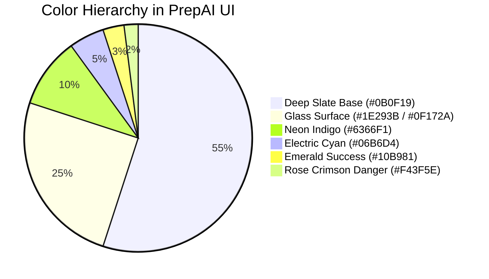

# 🎨 PrepAI — UI/UX Design System Specification

## 1. Design Aesthetics & Visual Identity

PrepAI employs a **Cyberpunk-Infused Enterprise Dark Theme**. It couples the high-contrast aesthetic loved by software engineers (reminiscent of IDEs like VS Code, JetBrains, and GitHub Dark) with modern **glassmorphism** surfaces and glowing neon accents.

---

## 2. Color Palette & Design Tokens



### Color Token Reference Table

| Token Name | Hex Code | Tailwind Equivalent | Usage in PrepAI |
| :--- | :--- | :--- | :--- |
| **Canvas Background** | `#0B0F19` | `bg-slate-950` / custom | Main app background, body backdrop |
| **Card / Modal Surface** | `#0F172A` | `bg-slate-900` | Modal panels, card containers, sidebars |
| **Subtle Glass Overlay** | `rgba(30, 41, 59, 0.7)` | `bg-slate-800/70 backdrop-blur-md` | Glass panels, floating navigation bars |
| **Border Highlight** | `rgba(148, 163, 184, 0.15)` | `border-slate-700/50` | Glass dividers, code editor borders |
| **Primary Accent (Indigo)** | `#6366F1` | `bg-indigo-600`, `text-indigo-400` | Primary buttons, active state tabs, links |
| **Secondary Accent (Cyan)** | `#06B6D4` | `bg-cyan-500`, `text-cyan-400` | AI proctor badges, stats counters, highlights |
| **Success / Test Pass** | `#10B981` | `bg-emerald-500`, `text-emerald-400` | Test pass pills, readiness badges (>80%) |
| **Warning / Attention** | `#F59E0B` | `bg-amber-500`, `text-amber-400` | Time expiring indicator, medium readiness |
| **Danger / Test Fail** | `#F43F5E` | `bg-rose-500`, `text-rose-400` | Syntax error banners, failed test cases |

---

## 3. Typography Hierarchy

The typography utilizes a clean sans-serif system font stack for maximum readability and zero external layout shifts, complemented by monospace for code:

* **Primary Heading Font**: System UI / Inter / Outfit (`font-sans tracking-tight`)
* **Code & Monospace Font**: Fira Code / JetBrains Mono / SF Mono / Consolas (`font-mono`)

| Level | Size / Weight | Tailwind Class | Applied To |
| :--- | :--- | :--- | :--- |
| **Display Hero** | `3rem` to `4rem` (48px–64px), Bold 800 | `text-5xl md:text-6xl font-extrabold` | Hero headline ("AI Placement Preparation Platform") |
| **Section Title** | `1.875rem` (30px), Bold 700 | `text-3xl font-bold` | Modal headers, feature section headings |
| **Subheadings** | `1.25rem` (20px), Semi-bold 600 | `text-xl font-semibold` | Card titles, daily roadmap milestones |
| **Body Text** | `0.938rem` (15px), Regular 400 | `text-sm md:text-base text-slate-300` | Explanations, curriculum tasks, prompt messages |
| **Micro Copy** | `0.75rem` (12px), Medium 500 | `text-xs text-slate-400` | Test case inputs, timestamps, status badges |
| **Code Display** | `0.875rem` (14px), Mono Regular | `font-mono text-sm` | Code editor buffer, test case inputs/outputs |

---

## 4. Glassmorphism & Elevation System

To achieve a depth-rich layout without cluttered borders:
* **Level 1 (Base Layer)**: Solid dark gradient background (`bg-gradient-to-b from-slate-950 via-slate-900 to-slate-950`).
* **Level 2 (Section Cards)**: Semi-opaque dark panels with fine hairline borders:
  ```css
  background: rgba(15, 23, 42, 0.75);
  backdrop-filter: blur(12px);
  border: 1px solid rgba(255, 255, 255, 0.08);
  box-shadow: 0 10px 30px -10px rgba(0, 0, 0, 0.5);
  ```
* **Level 3 (Modal Windows)**: Deep backdrop overlay (`bg-black/70 backdrop-blur-md`) with elevated center stage dialog, rounded corners (`rounded-2xl`), and inset rim lights (`shadow-2xl shadow-indigo-500/10`).

---

## 5. Micro-Animations & Motion Design

Framer Motion orchestrates physics-based transitions across user actions:
* **Modal Entrance**: Scale from `0.95` to `1.0` and opacity from `0` to `1` over 220ms with ease-out curve.
* **Button Hover Glow**: Scale `1.02` with slight translation and subtle ring glow.
* **Live Timer Pulse**: Critical threshold (< 5 minutes) triggers pulsing red badge with smooth opacity oscillation.
* **Tab Transitions**: Instant content switch paired with sliding highlight pill.

---

## 6. Accessibility & Keyboard Shortcuts (a11y)

* **Escape Key Dismiss**: All modals subscribe to a global `keydown` event listener, allowing users to close any open dialog immediately with the `ESC` key.
* **Scroll Locking**: When an active modal is displayed, body scrolling is stabilized to prevent dual-scroll confusion.
* **High-Contrast Text**: All text tokens exceed WCAG AA 4.5:1 contrast requirements against slate backgrounds.
* **Color + Icon Redundancy**: Status indicators (pass, fail, warning) always use both an icon (e.g., `CheckCircle2`, `AlertCircle`) and color so color-blind users can instantly distinguish test states.
